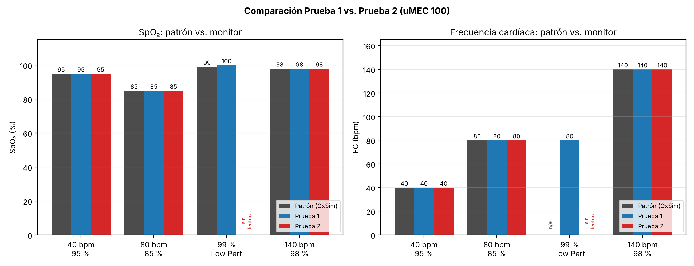
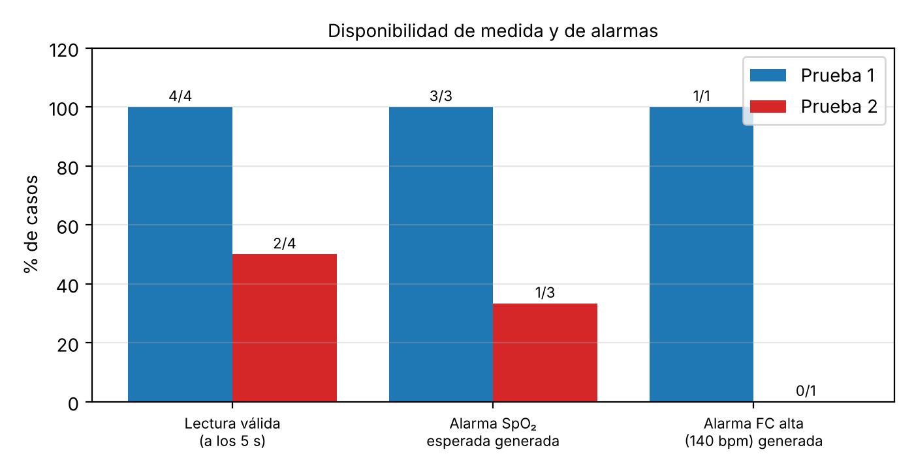

# Laboratorio 5: Simulación y Monitoreo de Variables Cardiovasculares y Hemodinámicas

**Asignatura:** Instrumentación Biomédica y Biosensores  
**Docente:** Erick Arguello
**Integrantes:**
* Sebastián López Duarte
* Paola Andrea Cepeda Castro
* José Daniel Porras Rodriguéz

---

## 1. Introducción 

En el ámbito clínico, la monitorización continua de variables fisiológicas críticas como la frecuencia cardíaca ($\text{HR}$) y la saturación periférica de oxígeno ($\text{SpO}_2$) es vital para la seguridad del paciente. Los equipos biomédicos deben ser capaces de detectar variaciones anómalas y activar alarmas oportunas ante riesgos inminentes (por ejemplo, bradicardias o hipoxias). 

Para verificar la respuesta técnica, los límites de medición y la correcta emisión de alarmas en los monitores de signos vitales (como el Mindray uMEC 100), se emplean simuladores especializados de parámetros hemodinámicos y de pulsioximetría, tales como el **Pronk OxSim OX-1**, que permiten recrear de forma controlada condiciones fisiológicas normales y patológicas.

---

## 2. Objetivos

### Objetivo General
* Operar con el simulador de parámetros hemodinámicos Pronk OxSim (OX-1) y el monitor de signos vitales uMEC 100 para realizar pruebas funcionales y de verificación de alarmas.

### Objetivos Específicos
* Identificar los modos de operación y características técnicas de un simulador de parámetros hemodinámicos (Pronk OxSim OX-1).
* Verificar los límites de medición, tiempos de respuesta y activación de alarmas de un monitor de signos vitales ante escenarios simulados.
* Interpretar las variaciones en los parámetros hemodinámicos y los errores de lectura comparados contra un equipo patrón.

---

## 3. Equipos Utilizados

| Descripción del Equipo / Dispositivo | Modelo / Referencia | Cantidad |
| :--- | :--- | :---: |
| Monitor de signos vitales con módulo de $\text{SpO}_2$ | Mindray uMEC 100 | 1 |
| Simulador de parámetros hemodinámicos (Patrón) | Pronk OxSim OX-1 | 1 |
| Pinza / Sensor de pulsioximetría ($\text{SpO}_2$) | Compatible con OxSim / uMEC 100 | 1 |
| Computador personal y herramientas de registro | Software de documentación | 1 |

### OxSim

Un oxSIM (simulador de oxigenación) es una herramienta de simulación utilizada en el ámbito biomédico para representar y estudiar los procesos relacionados con la oxigenación del organismo, permitiendo analizar variables como la concentración de oxígeno, la saturación de oxígeno en la sangre y el comportamiento de los sistemas de soporte respiratorio, según las características del simulador. Su importancia radica en que facilita la comprensión del funcionamiento del sistema respiratorio, permite evaluar diferentes condiciones de oxigenación y contribuye a la formación del personal de salud mediante escenarios controlados y seguros, sin necesidad de intervenir directamente sobre un paciente. Además, este tipo de simulación favorece el aprendizaje práctico, la evaluación de tecnologías biomédicas y la toma de decisiones clínicas, ayudando a mejorar la preparación de los profesionales y la seguridad en los procedimientos médicos.

Según el panel del equipo (visible en las fotografías), el OX-1 ofrece **cinco modos fijos** y un selector de sensor:

| Modo (selector MODE) | SpO₂ simulada | FC simulada |
| :---: | :---: | :---: |
| 1 | 85 % | 80 bpm |
| 2 | 95 % | 40 bpm (bradicardia) |
| 3 | 98 % | 80 bpm |
| 4 | 98 % | 140 bpm (taquicardia) |
| 5 | 99 % | *Low Perf* (baja perfusión; FC no indicada en el panel) |

El selector **SENSOR** permite elegir *Auto*, *HP/Ohm* u *Other* (en todas las pruebas se usó *Auto*), y los indicadores *Batt*, *IR* y *Red* muestran el estado de la batería y la actividad de los emisores de luz infrarroja y roja del sensor.

---
## 4. Metodología

### 4.1 Diseño experimental

Se aplicó el mismo protocolo de cuatro escenarios a dos configuraciones del monitor:

* **Prueba 1:** uMEC 100 que funcionó correctamente. Perfil "Valores predeterm. fábrica", paciente adulto, filtro de ECG en modo *Diagnóstico*.
* **Prueba 2:** uMEC 100 con comportamiento defectuoso (no entregaba los datos simulados en varios escenarios). Mismo perfil de fábrica, paciente adulto, filtro de ECG en modo *Cirugía* y prioridad de alarmas de SpO₂ en *Medio*.

En ambos casos el **patrón** es el OxSim OX-1, cuyo valor configurado se toma como valor verdadero convencional, y el **instrumento bajo prueba** es el uMEC 100.

> Como el ECG no estaba conectado (la pantalla muestra "Deriv ECG desconect."), la frecuencia cardíaca que se muestra proviene del pulso de SpO₂ (la pantalla indica *Origen: SpO₂*). Por tanto, la FC evaluada es en realidad la **frecuencia de pulso (FP)** derivada de la onda fotopletismográfica.

### 4.2 Procedimiento

El procedimiento siguió la guía de laboratorio (Parte B):

1. Construcción de la tabla de verificación de alarmas (límite configurado, valor simulado, ¿alarma activa? y tiempo de respuesta).
2. Encendido del uMEC 100 y selección del modo de monitorización.
3. Conexión de la pinza de pulsioximetría al OxSim OX-1.
4. **Paso 1 — Bradicardia:** OxSim en 95 % / 40 bpm. Registro de lecturas y de la forma de onda fotopletismográfica.
5. **Paso 2 — Hipoxia:** límite inferior de alarma de SpO₂ en 90 %. OxSim en 85 % / 80 bpm. Se esperaron 5 s y se verificó la alarma sonora/visual.
6. **Paso 3 — Baja perfusión:** límite superior de alarma de SpO₂ en 97 %. OxSim en 99 % (*Low Perf*). Se esperaron 5 s, se verificó la alarma y se observó la onda.
7. **Paso 4 — Taquicardia:** OxSim en 98 % / 140 bpm. Registro de la onda y verificación de la alarma de FC elevada.
8. En cada paso se fotografió la pantalla del uMEC 100 y el panel del OxSim.
9. Cálculo de errores y comparación entre pruebas.

### 4.3 Cálculo de errores

Para cada variable, con *V_patrón* el valor simulado por el OxSim y *V_monitor* el valor mostrado por el uMEC 100:
Cuando el monitor **no mostró ningún valor** (pantalla con "--"), el error no se puede calcular con estas fórmulas. En ese caso se reporta como **"sin lectura"** y se contabiliza como pérdida de la medida (equivalente a un 100 % de indisponibilidad en ese escenario).

### 4.4 Criterios de aceptación

* **SpO₂:** error dentro de ±2 % a ±3 % puntos de SpO₂ (rango típico de exactitud de pulsioxímetros; la norma ISO 80601-2-61 exige exactitud en el rango 70–100 %).
* **FC / frecuencia de pulso:** error dentro de ±3 bpm (valor típico de especificación de los módulos de SpO₂ de monitores de cabecera).
* **Alarmas:** debe activarse la alarma correspondiente cuando el valor simulado supera el límite configurado, con prioridad y mensaje coherentes, dentro del tiempo de verificación de 5 s indicado en la guía.

> Estas tolerancias son valores de referencia comunes y deben contrastarse con la especificación del manual del uMEC 100 y con la norma aplicable.

### 4.5 Registro y seguridad

Los datos se registraron mediante fotografías de las pantallas (con la hora del monitor visible) y se transcribieron a las tablas de este informe. Se siguieron las normas de seguridad de la guía: manipulación de los equipos solo con presencia del técnico, uso de bata, pantalón largo y cabello recogido, y sin dejar sesiones iniciadas en los equipos de cómputo institucionales.

## 5. Parte A 
### a. ¿Cómo colocar al uMEC 100 en modo "monitor"?

El uMEC 100 se enciende con el botón de encendido y, una vez iniciado, queda en la pantalla principal de monitorización con un paciente admitido (en las fotografías: paciente tipo **Adulto**, perfil "Valores predeterm. fábrica" y nombre de paciente "Prueba 1" / "Prueba 2"). Allí se muestran en tiempo real el ECG, la onda pletismográfica (Plet), SpO₂, respiración, temperatura y PANI.

En la parte superior izquierda de la pantalla se observa además el **modo de filtro de ECG**, que en monitores Mindray puede ser *Monitor*, *Diagnóstico* o *Cirugía*. En nuestras pruebas se usó *Diagnóstico* (Prueba 1) y *Cirugía* (Prueba 2). Este filtro afecta únicamente a la señal de ECG y no a la medida de SpO₂, pero conviene dejarlo registrado porque difiere entre pruebas.

> **Pendiente de verificar con el manual de operación del uMEC 100:** la ruta exacta del menú para seleccionar el filtro *Monitor* y la distinción entre el modo de monitorización normal, el modo de espera (*Standby*) y el modo de configuración/demo. La guía solicita contrastar esta información contra el manual.

### b. ¿Qué parámetros fisiológicos pueden simularse con el OxSim OX-1?

* **Saturación periférica de oxígeno (SpO₂):** porcentaje de hemoglobina oxigenada en sangre arterial. El OX-1 genera valores fijos de 85 %, 95 %, 98 % y 99 %, que permiten probar un valor de hipoxia, uno normal-bajo, uno normal y uno alto.
* **Frecuencia cardíaca / frecuencia de pulso (FC):** latidos por minuto reproducidos por la señal pulsátil: 40 bpm (bradicardia), 80 bpm (normal) y 140 bpm (taquicardia).
* **Perfusión / amplitud de pulso (modo *Low Perf*):** simula una señal pulsátil de amplitud muy reducida, típica de mala perfusión periférica, para evaluar la sensibilidad del monitor ante señales débiles. En el monitor se refleja como un **índice de perfusión (IP)** muy bajo (0.45 en la Prueba 1, frente a ≈4.1–4.4 en los demás modos).
* **Onda fotopletismográfica:** curva de variación del volumen sanguíneo sincronizada con el pulso, que el monitor dibuja en el canal *Plet*. Su frecuencia depende de la FC simulada y su amplitud del nivel de perfusión.

**Lo que el OxSim no simula:** el OX-1 no genera ECG, arritmias, presión arterial, respiración ni artefactos de movimiento, y solo ofrece combinaciones fijas de SpO₂/FC (no valores arbitrarios).

### c. Errores máximos permitidos (EMP) en el ámbito clínico

| Parámetro | EMP de referencia | Comentario |
| :--- | :---: | :--- |
| SpO₂ | ±2 % a ±3 % (puntos de SpO₂) | Rango típico de exactitud de pulsioxímetros de uso clínico en 70–100 %; la exactitud empeora por debajo de 70 % |
| FC / frecuencia de pulso | ±3 bpm (típico) | Algunos fabricantes especifican ±2 % o ±1 bpm. Valor a confirmar con el manual del equipo |

> Estos valores deben confirmarse con la hoja de especificaciones/manual del uMEC 100 y con la norma ISO 80601-2-61 antes de la entrega final.

---

## 6. Parte B — Pruebas

### 6.1 Registro de Datos Obtenidos (Patrón vs. Monitor)
A continuación se registran los datos experimentales obtenidos al conectar el equipo patrón (OxSim) al monitor de signos vitales, comparando una configuración defectuosa/errónea frente a la configuración exitosa:

| Condición / Ensayo | Parámetro Patrón ($\text{SpO}_2$ / $\text{HR}$) | Caso No Funcionó ($\text{SpO}_2$ / $\text{HR}$) | Caso Sí Funcionó ($\text{SpO}_2$ / $\text{HR}$) | Error Absoluto ($\text{SpO}_2$ / $\text{HR}$) | Error Porcentual ($\text{SpO}_2$ / $\text{HR}$) | Estado de Alarma |
| :---: | :---: | :---: | :---: | :---: | :---: | :--- |
| **1** | $85\% \text{ / } 80\text{ lpm}$ | *Sin registro* | $85\% \text{ / } 80\text{ lpm}$ | $0\% \text{ / } 0\text{ bpm}$ | $0\% \text{ / } 0\%$ | Sin alarma (Valores normales/esperados) |
| **2 (Bradicardia)** | $95\% \text{ / } 40\text{ lpm}$ | $94\% \text{ / } 80\text{ lpm}$ | $96\% \text{ / } 40\text{ lpm}$ | $\Delta\text{SpO}_2 = 1\%$ $\Delta\text{HR} = 0\text{ bpm}$ | $\text{SpO}_2: 1.05\%$ $\text{HR}: 0\%$ | **Activa** (Alarma por Bradicardia $< 50\text{ lpm}$) |
| **3** | $98\% \text{ / } 80\text{ lpm}$ | *Sin registro* | $98\% \text{ / } 80\text{ lpm}$ | $0\% \text{ / } 0\text{ bpm}$ | $0\% \text{ / } 0\%$ | Sin alarma |
| **4 (Taquicardia)** | $98\% \text{ / } 140\text{ lpm}$ | *Sin registro* | $98\% \text{ / } 140\text{ lpm}$ | $0\% \text{ / } 0\text{ bpm}$ | $0\% \text{ / } 0\%$ | **Activa** (Alarma por Taquicardia $> 120\text{ lpm}$) |

**Notas:**

1. En ambas pruebas la FC simulada de 40 bpm quedó por debajo del límite bajo configurado (45 y 50 bpm respectivamente), pero **en las fotografías no se observa ninguna alarma de FC baja**. No se registró si se escuchó una alarma sonora ni se midió el retardo de activación; este punto debe contrastarse con el manual (las alarmas de FC/FP pueden tener retardos y condiciones de activación) o repetirse.
2. La alarma `T1 baja < 35.0` es ajena a la prueba: el sensor de temperatura no estaba conectado y el monitor leía la temperatura ambiente (≈22 °C).
3. En la captura posterior (≈19 s después, según el contador "Deriv ECG desconect.") el monitor ya mostraba 140 bpm / 98 %, pero **no apareció la alarma de FC alta** (140 > 120) ni la de SpO₂ alta (98 > 97) que se esperaban con los límites configurados. Es posible que las alarmas estuvieran silenciadas o pausadas, lo cual no se verificó.

### 6.2 Registro de datos — Prueba 1 (equipo funcional)

**Paso 1 — Bradicardia (40 bpm, SpO₂ 95 %).** El monitor mostró 40 bpm y 95 %. La onda pletismográfica tiene un periodo largo (≈4 pulsos en la ventana visible) con ascenso rápido y descenso más lento.

| OxSim | uMEC 100 |
| :---: | :---: |
|  |  |

**Paso 2 — Hipoxia (80 bpm, SpO₂ 85 %), límite bajo = 90 %.** El monitor mostró 80 bpm y 85 % y activó la alarma roja `SpO2 bajo < 90`.

| OxSim | uMEC 100 |
| :---: | :---: |
|  |  |

**Paso 3 — Baja perfusión (99 %), límite alto = 97 %.** El monitor mostró 80 bpm y **100 %**, con un índice de perfusión de 0.45, y activó la alarma `SpO2 alto > 97`. La onda es de menor amplitud y con morfología más irregular que en los otros modos (ver respuesta en 6.4).

| OxSim | uMEC 100 |
| :---: | :---: |
|  |  |

**Paso 4 — Taquicardia (140 bpm, SpO₂ 98 %).** El monitor mostró 140 bpm y 98 %. Primero estaba activa la alarma de SpO₂ alta (98 > 97) y a continuación apareció la alarma `FP alta > 110`, con los valores resaltados en rojo.

| OxSim | uMEC 100 (SpO₂ alta) | uMEC 100 (FC alta) |
| :---: | :---: | :---: |
|  |  |  |

### 6.3 Registro de datos — Prueba 2 (equipo defectuoso)

**Paso 1 — Bradicardia (40 bpm, SpO₂ 95 %).** Lectura correcta (40 bpm / 95 %). La onda tiene forma diferente a la de la Prueba 1 (más "diente de sierra") y se dibuja en otro color; el índice de perfusión fue 4.17.

| OxSim | uMEC 100 |
| :---: | :---: |
|  |  |

**Paso 2 — Hipoxia (80 bpm, SpO₂ 85 %).** Antes de simular, se configuraron los límites en el menú *Ajuste alarma* (SpO₂ 100/90). Lectura correcta (80 bpm / 85 %) y alarma `SpO2 bajo < 90`, pero **en prioridad media (amarillo)** en lugar de alta (rojo) como en la Prueba 1.

| Límites configurados | OxSim | uMEC 100 |
| :---: | :---: | :---: |
|  |  |  |

**Paso 3 — Baja perfusión (99 %), límite alto = 97 %.** Tras ajustar el límite alto a 97 % (captura izquierda), **el monitor no mostró ningún valor de FC ni de SpO₂** (aparecen guiones) y generó las alarmas `!!!Sin pulso` y `!Exceso de luz para SpO2`. La onda sí se dibujaba, pero sin valores numéricos asociados.

| Límites configurados | OxSim | uMEC 100 |
| :---: | :---: | :---: |
|  |  |  |

**Paso 4 — Taquicardia (140 bpm, SpO₂ 98 %).** Inicialmente el monitor siguió sin mostrar valores (`Sin pulso`, `Exceso de luz para SpO2`) a pesar de dibujar una onda sinusoidal de alta frecuencia. Unos 19 s después mostró 140 bpm / 98 %, pero **sin alarma de FC alta ni de SpO₂ alta**.

| uMEC 100 (inicio) | OxSim | uMEC 100 (≈19 s después) |
| :---: | :---: | :---: |
|  |  |  |

### 6.4 Tabla de errores absoluto y porcentual (patrón vs. monitor)

**Prueba 1 (equipo funcional)**

| Paso | Patrón SpO₂ / FC | Monitor SpO₂ / FC | Error abs. SpO₂ | Error % SpO₂ | Error abs. FC | Error % FC |
| :---: | :---: | :---: | :---: | :---: | :---: | :---: |
| 1 (bradicardia) | 95 % / 40 bpm | 95 % / 40 bpm | 0 | 0 % | 0 bpm | 0 % |
| 2 (hipoxia) | 85 % / 80 bpm | 85 % / 80 bpm | 0 | 0 % | 0 bpm | 0 % |
| 3 (*Low Perf*) | 99 % / n.e.* | 100 % / 80 bpm | 1 | 1.01 % | n.e.* | n.e.* |
| 4 (taquicardia) | 98 % / 140 bpm | 98 % / 140 bpm | 0 | 0 % | 0 bpm | 0 % |

**Prueba 2 (equipo defectuoso)**

| Paso | Patrón SpO₂ / FC | Monitor SpO₂ / FC | Error abs. SpO₂ | Error % SpO₂ | Error abs. FC | Error % FC |
| :---: | :---: | :---: | :---: | :---: | :---: | :---: |
| 1 (bradicardia) | 95 % / 40 bpm | 95 % / 40 bpm | 0 | 0 % | 0 bpm | 0 % |
| 2 (hipoxia) | 85 % / 80 bpm | 85 % / 80 bpm | 0 | 0 % | 0 bpm | 0 % |
| 3 (*Low Perf*) | 99 % / n.e.* | **Sin lectura** | No calculable | — (pérdida de medida) | n.e.* | n.e.* |
| 4 (taquicardia) | 98 % / 140 bpm | Sin lectura a los 5 s; **98 % / 140 bpm** a los ≈19 s | 0 (tras recuperar) | 0 % (tras recuperar) | 0 bpm (tras recuperar) | 0 % (tras recuperar) |

\* *n.e.: la frecuencia cardíaca del modo *Low Perf* no está especificada en el panel del OxSim. El monitor mostró 80 bpm, lo cual es consistente con el modo de 80 bpm, pero no se tiene un patrón documentado contra el cual calcular el error.*

### 6.5 Respuestas a las preguntas de la guía (Parte B)

**¿La onda fotopletismográfica se distorsiona en el modo *Low Perf* (paso 9)?**
Sí, en la Prueba 1 la onda se observa de menor amplitud y con una morfología más irregular que en los modos de 85 % y 98 %, coherente con el índice de perfusión de 0.45 que reporta el monitor (frente a ≈4.1–4.4 en los demás pasos). Con una señal pulsátil tan débil, el cociente señal/ruido disminuye y la forma de la onda se vuelve menos fiable. En la Prueba 2 el monitor dibujó la onda pero no pudo calcular valores.

**¿Se dispara la alarma de frecuencia cardíaca elevada con 140 bpm (paso 10)?**
* **Prueba 1: Sí.** Apareció `!!!FP alta > 110` (límite alto de FC de 110 bpm) con los valores resaltados en rojo.
* **Prueba 2: No fue observada** en la captura, aunque el monitor ya mostraba 140 bpm con un límite alto de 120 bpm.

**Relación entre la forma de onda y la FC.** En la ventana de unos 6 s que muestra la pantalla se cuentan ≈4 pulsos a 40 bpm, ≈8 a 80 bpm y ≈14 a 140 bpm, lo que concuerda con el cociente 40 : 80 : 140 (periodos de 1.5 s, 0.75 s y 0.43 s).

---

## 7. Comparación entre Prueba 1 y Prueba 2 (análisis del error)

### 7.1 Valor esperado vs. valor obtenido

*En el escenario de 99 % (Low Perf) la Prueba 2 no tiene barra porque no hubo lectura. En el escenario de 140 bpm la barra de la Prueba 2 corresponde a la lectura obtenida ≈19 s después de simular, no a los 5 s de la guía.*

### 7.2 Variación del error por escenario

| Escenario | Esperado (patrón) | Obtenido Prueba 1 | Obtenido Prueba 2 | Error P1 (SpO₂ / FC) | Error P2 (SpO₂ / FC) | Variación P2 − P1 |
| :--- | :---: | :---: | :---: | :---: | :---: | :--- |
| 40 bpm / 95 % | 95 % / 40 | 95 % / 40 | 95 % / 40 | 0 % / 0 % | 0 % / 0 % | Ninguna |
| 80 bpm / 85 % | 85 % / 80 | 85 % / 80 | 85 % / 80 | 0 % / 0 % | 0 % / 0 % | Ninguna en la lectura; **cambia la prioridad de la alarma** (alta → media) |
| 99 % *Low Perf* | 99 % / n.e. | 100 % / 80 | **Sin lectura** | 1.01 % / n.e. | No calculable | **Pérdida total de la medida**; no hay alarma de SpO₂ alta |
| 140 bpm / 98 % | 98 % / 140 | 98 % / 140 | Sin lectura a los 5 s; 98 % / 140 a los ≈19 s | 0 % / 0 % | 0 % / 0 % (tras ≈19 s) | **Retraso de ≈19 s** y **ausencia de alarma de FC alta y de SpO₂ alta** |

### 7.3 Indicadores estadísticos descriptivos

Con solo cuatro escenarios por prueba, el análisis es **descriptivo** y no permite pruebas de hipótesis con potencia razonable.

| Indicador | Prueba 1 | Prueba 2 |
| :--- | :---: | :---: |
| Error absoluto medio de SpO₂ (lecturas válidas) | 0.25 puntos (n = 4) | 0 puntos (n = 3) |
| Error cuadrático medio (RMSE) de SpO₂ | 0.50 puntos | 0 puntos |
| Error absoluto máximo de SpO₂ | 1 punto (Low Perf) | 0 puntos |
| Error absoluto medio de FC (lecturas válidas con patrón) | 0 bpm (n = 3) | 0 bpm (n = 3 tras recuperar la señal) |
| Escenarios con lectura válida a los 5 s | **4 / 4** | **2 / 4** |
| Alarmas de SpO₂ esperadas que se generaron | **3 / 3** | **1 / 3** |
| Alarma de FC alta (140 bpm) generada | **1 / 1** | **0 / 1** |
| Errores dentro de la tolerancia (SpO₂ ±2 %; FC ±3 bpm) | 100 % de las lecturas | 100 % de las lecturas válidas |

### 7.4 Interpretación

* **El error en las lecturas válidas fue prácticamente nulo en ambas pruebas** (máximo 1 punto de SpO₂, dentro de la tolerancia). Es decir, cuando la Prueba 2 logró medir, midió bien.
* **La diferencia entre un equipo funcional y uno defectuoso no estuvo en la exactitud sino en la disponibilidad de la medida y de las alarmas.** La Prueba 2 perdió la señal en los escenarios de baja perfusión y de taquicardia, y no emitió las alarmas esperadas. Esto es más grave desde el punto de vista clínico que un error de 1–2 %, porque un monitor que no mide o que no alarma no alerta al personal ante un evento real.
* Medir el desempeño solo con el error porcentual habría ocultado el defecto: **el error medio de la Prueba 2 (0 %) es mejor que el de la Prueba 1 (0.25 %)** únicamente porque se excluyen los escenarios sin lectura. Por eso se reportan también la disponibilidad y las alarmas generadas.
* Los mensajes `!Exceso de luz para SpO2` y `!!!Sin pulso` indican que el canal óptico no estaba recibiendo una señal pulsátil utilizable. Las posibles causas que debe revisar el laboratorio son: mal acople óptico entre el OxSim y la pinza, luz ambiental, sensor o cable en mal estado, módulo de SpO₂ con fallo de ganancia o de calibración, o diferencia en la configuración del sensor. A partir de las fotografías **no es posible determinar cuál fue la causa raíz**; el equipo se clasifica como defectuoso por su comportamiento, no por una medición de calibración independiente.

---

## 8. Análisis de resultados

> **Nota sobre la guía:** las secciones 12–14 de la guía mencionan un "BeneHeart D30" y la energía de un desfibrilador, lo cual parece un residuo de otra práctica. Los análisis se adaptaron al equipo realmente usado (uMEC 100) y a las variables medidas (SpO₂ y FC).

### Análisis 1 — Diferencias entre los valores de referencia y los mostrados por el monitor

Se compararon los valores del patrón (OxSim) con los mostrados por el uMEC 100 (secciones 6.4 y 7.3). En la Prueba 1 la diferencia máxima fue de 1 punto de SpO₂ (1.01 %) en el modo *Low Perf*, y 0 bpm en la FC; en la Prueba 2 las lecturas obtenidas coincidieron con el patrón, pero en dos de los cuatro escenarios no hubo lectura dentro de los 5 s. Todas las lecturas válidas cumplen la tolerancia de referencia. La lectura de 100 % para un patrón de 99 % en *Low Perf* está dentro de la exactitud esperada del pulsioxímetro y es probable que se deba a la baja amplitud de la señal.

### Análisis 2 — Relación entre la forma de onda y la FC / SpO₂

* **Frecuencia cardíaca:** el número de pulsos visibles por ventana de tiempo es proporcional a la FC (≈4, 8 y 14 pulsos a 40, 80 y 140 bpm). A 140 bpm la onda se vuelve casi sinusoidal porque el periodo es tan corto (≈0.43 s) que no se alcanza a distinguir la fase de descenso.
* **Perfusión:** la amplitud de la onda y el índice de perfusión se relacionan directamente con la intensidad de la señal pulsátil. En *Low Perf* el IP cae a 0.45 y la onda se degrada.
* **SpO₂:** la saturación no se aprecia directamente en la forma de la onda de un solo canal; se calcula a partir de la relación entre los componentes pulsátil (AC) y continuo (DC) de las señales rojo e infrarroja. Por eso un cambio de 85 % a 98 % no modifica de forma evidente la onda mostrada, mientras que un cambio de FC o de perfusión sí lo hace.

---

## 9. Parte C — Preguntas para la Discusión

1. **¿Cuál es el principio de operación del Pronk OxSim OX-1 para simular una onda pulsátil?**  
   El OxSim simula ópticamente la transmisión y absorción de luz mediante diodos infrarrojos y rojos acoplados al sensor de pulsioximetría, modulando la intensidad lumínica de manera sincronizada con la frecuencia cardíaca configurada para imitar los cambios volumétricos del lecho capilar.

2. **¿Por qué la $\text{SpO}_2$ baja puede ser un falso positivo (falsa alarma) en una situación de mala perfusión?**  
   Ante una mala perfusión, la amplitud del pulso óptico disminuye reduciendo la relación señal-ruido ($\text{SNR}$). El algoritmo del oxímetro puede confundir el ruido con la señal real, interpretando caídas ficticias en la saturación sin que exista hipoxia real en el paciente.

---

## 10. Conclusiones

La práctica permitió evaluar el funcionamiento del monitor de signos vitales Mindray uMEC 100 mediante el simulador Pronk OxSim OX-1, comprendiendo su utilidad en la verificación de parámetros cardiovasculares y hemodinámicos. Durante los ensayos se identificó que una conexión o configuración inadecuada puede generar errores en las mediciones, especialmente en la frecuencia cardíaca, afectando la interpretación de los resultados. Sin embargo, después de corregir estas condiciones, el monitor logró registrar valores cercanos a los establecidos por el equipo patrón. Asimismo, se comprobó la activación de las alarmas ante condiciones de bradicardia y taquicardia, demostrando la importancia de estos sistemas para identificar posibles alteraciones fisiológicas. También se reconoció que la saturación de oxígeno y la frecuencia cardíaca son variables fundamentales para evaluar el estado general de un paciente. Por otra parte, el uso del simulador permitió realizar pruebas controladas sin poner en riesgo a una persona, facilitando la identificación de posibles fallas del equipo. Finalmente, esta experiencia permitió fortalecer los conocimientos sobre el manejo, la evaluación y la verificación de equipos biomédicos, destacando la importancia de garantizar mediciones confiables y respuestas oportunas de las alarmas en el entorno clínico.

---
## 11. Limitaciones y recomendaciones

* Cada escenario se registró **una sola vez** (sin repeticiones), por lo que no es posible estimar repetibilidad ni incertidumbre de medida.
* El **tiempo de respuesta** de las alarmas no se midió con cronómetro; solo se verificó su activación al cabo de los 5 s indicados en la guía.
* No se documentó si el sensor, el cable y el OxSim eran **los mismos** en ambas pruebas, lo cual impide aislar la causa del fallo de la Prueba 2.
* Según la hora mostrada por las pantallas, la Prueba 2 se registró entre las 15:26 y las 15:37 y la Prueba 1 a partir de las 15:45; el orden numérico no coincide con el cronológico.
* **Recomendaciones:** repetir cada escenario al menos tres veces, intercambiar sensores entre monitores para aislar la causa del fallo, registrar el tiempo de activación de cada alarma y contrastar las tolerancias con la especificación del fabricante.

---
## 12. Referencias Bibliográficas

[1] Instituto de Salud Pública de Chile (ISP), "Guía para la Clasificación de Dispositivos Médicos según Riesgo," ISPCH, Santiago, Chile, Guía técnica, 2021[cite: 20].  
[2] Instituto Nacional de Vigilancia de Medicamentos y Alimentos (INVIMA), *ABC de Dispositivos Médicos - Guía Reguladora*, Bogotá, Colombia: INVIMA[cite: 20].  
[3] Medical IT, "Metrología Biomédica - Simulador OxSim," [En línea]. Disponible en: [https://www.medicalitech.com/producto/ox-sim/](https://www.medicalitech.com/producto/ox-sim/)[cite: 20].
